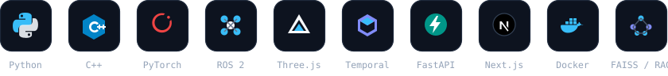
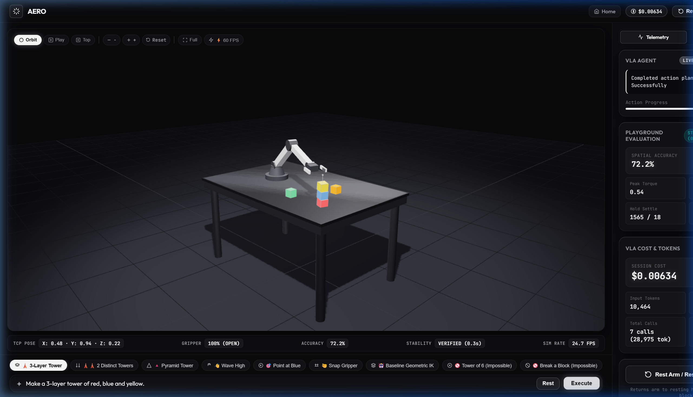
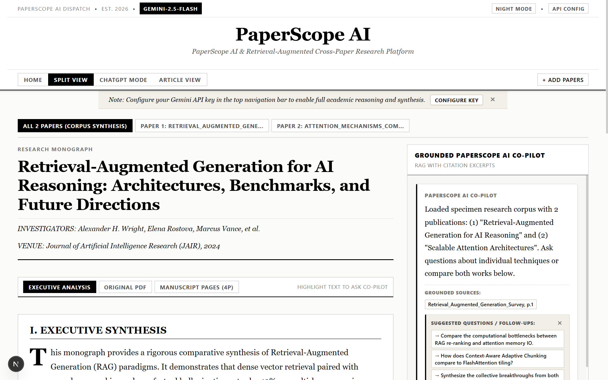
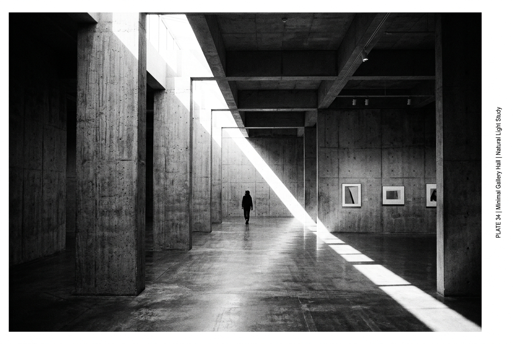

  

I engineer systems at the frontier where agentic reasoning, distributed backends, and physical autonomy meet: simulated 5 DOF robotic arms with real-time inverse kinematics, resilient multi-agent ingestion pipelines orchestrated with Temporal, sub-second hybrid RAG synthesis engines, and edge vision models for automated quality inspection. I focus on the hard engineering: taking stochastic model outputs and grounding them in deterministic, fault-tolerant execution.

<h3 align="center">Stack</h3>

## Featured

<table>
  <tr>
    <td width="50%" valign="top">
      
      <h3><a href="https://github.com/incheif/Aero">AERO Platform</a> · <a href="https://aero-live.onrender.com/">Live Studio</a></h3>
      Simulation-first agentic robotics platform translating natural language directives into manipulation tasks. Powered by 5 DOF geometric inverse kinematics, tabletop spatial exploration, deterministic local execution, and a 60 FPS Three.js WebGL telemetry studio.
    </td>
    <td width="50%" valign="top">
      
      <h3><a href="https://github.com/incheif/PaperScope-AI">PaperScope AI</a> · <a href="https://paper-scope.onrender.com/">Live Studio</a></h3>
      Full-stack academic research RAG platform with sub-second routing between Gemini 2.5 and Groq-hosted Llama 3.3 70B. Features tri-tier passage chunking, FAISS vector retrieval with TF-IDF fallback, verifiable page-level citations, and BibTeX synthesis.
    </td>
  </tr>
  <tr>
    <td width="50%" valign="top">
      
      <h3>Autonomous KYC Extraction Engine · <a href="https://kychub.com">KYC Hub</a></h3>
      Two-agent autonomous architecture (investigative agent for DOM analysis + datasource coder agent for Python scraper synthesis) that automates global AML source onboarding. Orchestrated with Temporal for fault-tolerant, distributed execution.
    </td>
    <td width="50%" valign="top">
      
      <h3>Automated Antenna Quality Sign-Off · <a href="https://www.hughes.com">Hughes</a></h3>
      Deep learning computer vision pipeline combining custom CNNs and YOLOv8 to verify correct satellite dish installation from field photographs. Automated manual QA sign-offs alongside real-time Python geospatial terminal tracking.
    </td>
  </tr>
</table>

## Autonomous Agents & Physical Intelligence

| Project | What it does |
|:--|:--|
| [**AERO Platform**](https://github.com/incheif/Aero) · [**Live Studio**](https://aero-live.onrender.com/) | Simulation-first robotics platform translating natural language commands into physical manipulation tasks (block stacking, pyramid assembly) via 5 DOF geometric inverse kinematics, tabletop spatial mapping, and Three.js telemetry. |
| **KYC AML Multi-Agent Engine** (KYC Hub) | Distributed two-agent architecture automating global AML source onboarding (sanctions, PEPs, criminal records) with Temporal durable workflow DAGs and automated DOM schema discovery. |
| [**Data-AI**](https://github.com/incheif/Data-AI) | Conversational dataset interrogation platform executing natural-language statistical exploration, automated anomaly detection, and reactive parameter chart synthesis via LLM tool execution. |

## Neural Search, RAG & Distributed Backends

| Project | What it does |
|:--|:--|
| [**PaperScope AI**](https://github.com/incheif/PaperScope-AI) · [**Live Studio**](https://paper-scope.onrender.com/) | Academic research intelligence RAG engine with sub-second hybrid routing (Gemini 2.5 / Groq Llama 3.3 70B), tri-tier passage chunking, FAISS vector indexing, and verifiable page-level citations. |
| **AI Candidate Semantic Matching** (Shorthills AI) | Semantic job matching with Azure OpenAI embeddings & Elasticsearch; automated multi-format CV ingestion with LlamaParse & Tesseract OCR; modular Apache NiFi streaming pipelines. |
| [**CivicLens**](https://github.com/incheif/civiclens) | Mobile-first civic hazard platform featuring coordinate-based polygon geofencing, duplicate incident clustering, Leaflet mapping, and real-time community tallies. |

## Computer Vision & High-Throughput Pipelines

| Project | What it does |
|:--|:--|
| **Satellite Dish Alignment & Quality Sign-Off** (Hughes) | Deep learning YOLOv8 & CNN perception models detecting and verifying antenna alignment from field imagery, automating operational quality sign-offs. |
| **Real-Time Terminal Tracking** (Hughes) | Distributed endpoint telemetry system executing SQL spatial queries and OpenStreetMap geofencing with 5-minute automated refresh cycles. |

## Career Footprint

| Organization & Period | Role | Engineering Impact | Key Stack |
|:--|:--|:--|:--|
| **KYC Hub** `Jan 2026 – Present` | AI Engineer (Remote UK) | Architected agentic AI source onboarding with a two-agent architecture; deployed Temporal for distributed workflow orchestration; automated DOM extraction pipelines. | `Agentic AI` · `Temporal` · `FastAPI` · `Python` |
| **Shorthills AI** `Feb 2025 – Aug 2025` | AI Intern (Gurugram) | Engineered candidate semantic matching with Elasticsearch & Azure OpenAI; built heterogeneous CV ingestion using LlamaParse & Tesseract OCR; automated NiFi pipelines. | `Elasticsearch` · `Azure OpenAI` · `LlamaParse` · `NiFi` |
| **Hughes Communication** `Jun 2024 – Aug 2024` | SDE Intern (Gurugram) | Trained YOLOv8 & CNN models to automate satellite antenna installation quality verification; built geospatial terminal monitoring with SQL spatial queries. | `YOLOv8` · `PyTorch` · `OpenCV` · `Geospatial` |

## How I build

- **Deterministic execution over probabilistic hope.** Autonomous agents must be bounded by typed schemas, state machines, and Temporal workflows that survive node crashes.
- **Physical reality is the ultimate benchmark.** Software intelligence is validated when it perceives spatial environments and reliably manipulates real-world objects.
- **Sub-second latency or re-architect the retrieval.** Tri-tier adaptive chunking, streaming inference, and semantic caching beat brute-force compute.
- **Production-grade from commit zero.** Prototypes prove feasibility; Dockerized microservices, comprehensive telemetry, and CI/CD prove durability.

## Activity

  
  

## Let's build

Open to collaborations with teams advancing Agentic AI, Robotics, Physical Intelligence, and Scalable Systems.

  
  
  
  
  

