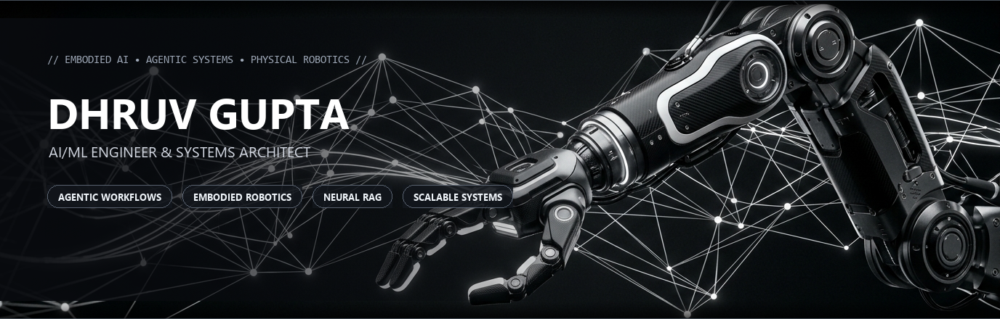

<div align="center">

  <!-- Hero Header Banner (Monochromatic Luxury Design) -->
  <a href="https://the-dhruvgupta-portfolio.vercel.app/" target="_blank">
    
  </a>

  <br/><br/>

  <!-- Dynamic Typing Subtitle -->
  <a href="https://github.com/incheif">
    
  </a>

  <br/>

  <!-- Interactive Social & Portfolio Dock -->
  <p align="center">
    <a href="https://the-dhruvgupta-portfolio.vercel.app/" target="_blank">
      
    </a>
    <a href="https://www.linkedin.com/in/dhruv-gupta45" target="_blank">
      
    </a>
    <a href="https://x.com/incheif01" target="_blank">
      
    </a>
    <a href="mailto:guptadhruv959@gmail.com" target="_blank">
      
    </a>
    <a href="https://github.com/incheif" target="_blank">
      
    </a>
  </p>

  <!-- Glowing Divider -->
  

</div>

<br/>

## 🛰️ About Me

```yaml
identity:
  name: "Dhruv Gupta"
  role: "AI/ML Engineer & Systems Architect"
  alma_mater: "Delhi Technological University (DTU)"
  current_focus: "Agentic AI Systems, Physical Autonomy & Robotics"

core_pillars:
  - "Designing agentic AI workflows that self-plan, validate, and execute complex operations"
  - "Connecting machine intelligence to the physical world through robotics and spatial AI"
  - "Building low-latency RAG architectures, multi-modal ingestion, and neural search engines"
  - "Engineering fault-tolerant distributed backends with Temporal, FastAPI, and Docker"
```

<table>
  <tr>
    <td width="58%" valign="top">
      <h3>⚡ Engineering Philosophy</h3>
      <p>
        I specialize in bridging the gap between cutting-edge AI models and production-grade software architectures. From building autonomous compliance extraction agents powered by <b>Temporal</b> at <b>KYC Hub</b> to engineering real-world computer vision pipelines (YOLOv8, CNNs) and research intelligence platforms like <b>PaperScope AI</b>, I engineer systems that are reliable, performant, and purposeful.
      </p>
      <p>
        Currently advancing <b>AERO</b>—an agentic robotics platform translating natural language directives into grounded robotic actions, bringing physical intelligence to life.
      </p>
    </td>
    <td width="42%" align="center" valign="middle">
      
      <br/>
      <sub><i>Bridging Software Intelligence with Physical Systems</i></sub>
    </td>
  </tr>
</table>

<div align="center">
  
</div>

<br/>

## 🏆 Featured Architectures & Star Projects

<table>
  <thead>
    <tr>
      <th width="35%">Project</th>
      <th width="45%">Description & Architecture</th>
      <th width="20%">Tech Stack</th>
    </tr>
  </thead>
  <tbody>
    <tr>
      <td>
        <b><a href="https://github.com/incheif/PaperScope-AI">📄 PaperScope AI</a></b>
        <br/>
        <sub>Academic Research Intelligence Engine</sub>
      </td>
      <td>
        Full-stack research paper assistant featuring broadsheet newspaper UX, integrated PDF manuscript reader, contextual section interrogations, and multi-modal RAG.
      </td>
      <td>
        
        
        
      </td>
    </tr>
    <tr>
      <td>
        <b><a href="https://github.com/incheif/Aero">🤖 AERO Platform</a></b>
        <br/>
        <sub>Agentic Robotics & Physical AI</sub>
      </td>
      <td>
        Translates natural language instructions into validated multi-step robotic tasks, autonomous path planning, and spatial sensor-fusion actions.
      </td>
      <td>
        
        
        
      </td>
    </tr>
    <tr>
      <td>
        <b><a href="https://github.com/incheif/civiclens">🌐 CivicLens</a></b>
        <br/>
        <sub>Mobile-First Civic Engagement Platform</sub>
      </td>
      <td>
        Decentralized platform for transparent community issue reporting, geospatial geofencing, automated incident clustering, and democratic issue prioritization.
      </td>
      <td>
        
        
        
      </td>
    </tr>
    <tr>
      <td>
        <b><a href="https://github.com/incheif/Data-AI">📊 Data-AI</a></b>
        <br/>
        <sub>Autonomous Data Exploration Engine</sub>
      </td>
      <td>
        Interactive platform enabling conversational data interrogation, automated statistical analysis, anomaly detection, and instant visualization generation.
      </td>
      <td>
        
        
        
      </td>
    </tr>
  </tbody>
</table>

<div align="center">
  
</div>

<br/>

## 💼 Professional Experience

<table>
  <tr>
    <td width="32%" valign="top">
      <h4>🏢 KYC Hub</h4>
      <sub><b>AI Engineer</b></sub><br/>
      <sub>📅 Jan 2026 – Present</sub><br/>
      <sub>🌍 Remote • UK FinTech</sub>
      <br/><br/>
      
      
      
    </td>
    <td width="68%" valign="top">
      <ul>
        <li><b>Autonomous Compliance Agents:</b> Architected and deployed agentic AI systems automating the onboarding of global compliance sources, drastically reducing manual engineering overhead in scraper development.</li>
        <li><b>Temporal Workflow Orchestration:</b> Managed scalable, fault-tolerant workflows and activities for complex data extraction pipelines, ensuring resilient execution of long-running agentic tasks.</li>
        <li><b>Autonomous DOM Analysis:</b> Engineered workflows that autonomously inspect DOM structures to synthesize execution plans, validation logic, and schema mappings for structured data extraction.</li>
      </ul>
    </td>
  </tr>
  <tr>
    <td width="32%" valign="top">
      <h4>🔬 Shorthills AI</h4>
      <sub><b>AI Intern</b></sub><br/>
      <sub>📅 Feb 2025 – Aug 2025</sub><br/>
      <sub>📍 Gurugram, India</sub>
      <br/><br/>
      
      
      
    </td>
    <td width="68%" valign="top">
      <ul>
        <li><b>Semantic Matching Engine:</b> Built an AI-powered candidate job matching and ranking system using Elasticsearch and Azure OpenAI (GPT models) for high-precision candidate filtering.</li>
        <li><b>Multi-Modal Document Ingestion:</b> Built resilient parsing pipelines handling heterogeneous resume formats (PDF, DOC, JPG, and scanned documents) via LlamaParse and Tesseract OCR.</li>
        <li><b>Neural Embeddings & Search:</b> Generated vector embeddings with OpenAI text-embedding models for cosine semantic similarity search, and automated standardized resume generation.</li>
      </ul>
    </td>
  </tr>
  <tr>
    <td width="32%" valign="top">
      <h4>📡 Hughes Communication</h4>
      <sub><b>Software Development Intern</b></sub><br/>
      <sub>📅 June 2024 – Aug 2024</sub><br/>
      <sub>📍 Gurugram, India</sub>
      <br/><br/>
      
      
      
    </td>
    <td width="68%" valign="top">
      <ul>
        <li><b>Real-Time Geospatial Tracking:</b> Developed a real-time terminal tracking system in Python with automated 5-minute data refreshes, integrating REST APIs for live telemetry ingestion.</li>
        <li><b>Geofencing & Network Automation:</b> Implemented state/district and radius geofencing logic triggering automated internet restrictions, status notifications, and spatial event logging.</li>
        <li><b>Computer Vision Quality Sign-Off:</b> Trained CNN and YOLOv8 models to detect correct placement and alignment of satellite dish antennas, automating manual inspection sign-offs.</li>
      </ul>
    </td>
  </tr>
</table>

<div align="center">
  
</div>

<br/>

## 🛠️ Technical Arsenal

<div align="center">

### 💻 Programming Languages
<p>
  
  
  
  
  
  
</p>

### 🧠 Artificial Intelligence, Machine Learning & Vision
<p>
  
  
  
  
  
  
  
  
</p>

### ⚡ Backends, Distributed Systems & Frameworks
<p>
  
  
  
  
  
  
  
</p>

### 🗄️ Databases, Vector Stores & Search
<p>
  
  
  
  
  
</p>

### ☁️ Cloud, DevOps & Environments
<p>
  
  
  
  
  
  
</p>

</div>

<div align="center">
  
</div>

<br/>

## 📊 GitHub Analytics & Telemetry

<div align="center">
  <table>
    <tr>
      <td width="50%" align="center" valign="middle">
        <a href="https://github.com/incheif">
          
        </a>
      </td>
      <td width="50%" align="center" valign="middle">
        <a href="https://github.com/incheif">
          
        </a>
      </td>
    </tr>
  </table>
</div>

<div align="center">
  
</div>

<br/>

## 🤝 Let's Connect & Collaborate

<div align="center">
  <p>I'm always open to discussing <b>Agentic AI</b>, <b>Physical Intelligence / Robotics</b>, and <b>Scalable System Architecture</b>.</p>

  <p>
    <a href="https://the-dhruvgupta-portfolio.vercel.app/" target="_blank">
      
    </a>
    &nbsp;&nbsp;
    <a href="https://www.linkedin.com/in/dhruv-gupta45" target="_blank">
      
    </a>
    &nbsp;&nbsp;
    <a href="mailto:guptadhruv959@gmail.com" target="_blank">
      
    </a>
  </p>

  <br/>

  <p>
    
  </p>

  <sub>Crafted with precision & passion by <b>Dhruv Gupta</b> • Powered by Systems & Code</sub>

</div>
